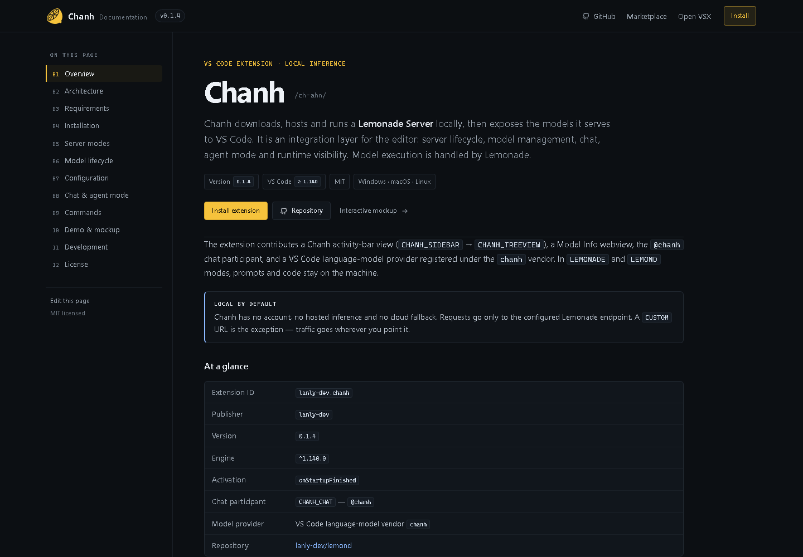

# Chanh documentation

A static, one-page technical reference for the Chanh VS Code extension. It covers architecture, server modes, model lifecycle, configuration, commands and the chat/agent integration, with the demo and UI mockup as supporting material.



## Content

The page is organized into thirteen anchored sections:

1. Overview
2. Architecture
3. Requirements
4. Installation
5. Server modes
6. Model lifecycle
7. Configuration
8. Chat and agent mode
9. Commands
10. Demo and mockup
11. Development
12. Audio lab
13. License

The contents sidebar, mobile contents block and section anchors are all in [`index.html`](index.html). If you add or rename a section, update both contents lists in that file.

## Preview locally

From the repository root:

```bash
python -m http.server 8000 --directory website
```

Then open <http://localhost:8000/>. A local server is recommended so directory links behave the same as on GitHub Pages.

## Deploy to GitHub Pages

The workflow at [`.github/workflows/pages.yml`](../.github/workflows/pages.yml) publishes the `website/` folder as a Pages artifact.

1. Push this repository to GitHub.
2. Open **Settings → Pages**.
3. Under **Build and deployment**, set **Source** to **GitHub Actions**.
4. Run the **Deploy website** workflow, or push a change under `website/`.

> **If the workflow fails at `actions/configure-pages` with a 404**, Pages is not enabled yet. Open **Settings → Pages → Build and deployment** and set **Source** to **GitHub Actions**, then re-run the workflow. GitHub Pages on private repositories requires a plan that supports it; otherwise make the repository public.

For the current remote (`lemond`), the site is published at **<https://lanly-dev.github.io/lemond/>**.

## YouTube demo

The 1:57 MP4 is intentionally **not committed**. The demo section shows the poster as a placeholder and says the video is coming to YouTube.

When the video is published:

1. Set the URL at the top of [`site.js`](site.js):

   ```js
   const YOUTUBE_URL = 'https://youtu.be/XXXXXXXXXXX'
   ```

2. Commit and push. The poster button now opens YouTube, the badge changes to **Watch on YouTube**, and the note links to the video.

The MP4 is ignored by git (`*.mp4`). Do not force-add `demo/Chanh-UI-Demo.mp4`; only the poster and notes belong in the repository.

## Repository name

The canonical URL, Open Graph tags and GitHub links currently assume the repository is named **`lemond`** (the current remote). If the repository is renamed (for example back to `vscode-chanh`), update:

- the `canonical` and `og:url` values in [`index.html`](index.html)
- the absolute `og:image` / `twitter:image` URLs
- the GitHub links in the header, footer and install section

Relative links to `./demo/`, `./mockup/` and `./assets/` do not need changing.

## Structure

```
website/
├─ index.html              # one-page technical documentation
├─ styles.css              # documentation theme
├─ site.js                 # contents highlighting, copy, YouTube link
├─ 404.html
├─ preview.png             # current page preview
├─ assets/
│  ├─ chanh.svg            # logo / favicon
│  └─ chanh-in-vscode.png  # extension screenshot
├─ demo/                   # poster + notes (MP4 excluded)
└─ mockup/                 # self-contained interactive mockup
```

## Notes

- No build step and no runtime dependencies.
- The contents sidebar is sticky on desktop; below 860px it becomes the collapsible **On this page** block.
- `site.js` highlights the current section, adds copy buttons to code blocks and handles the YouTube placeholder.
- Only the poster frame is committed; the demo MP4 stays out of git and is published on YouTube.
- `mockup/` is fully self-contained and can be opened directly or served at `/mockup/`.

## Design system

The documentation theme uses a low-contrast palette with a reduced-contrast dark background (`#0f1217` in dark mode) and soft text colors (`#c6d1dc`) so the page never competes with content.

A warm gold accent matching the logo (`#f2c744` dark mode / `#d9a92c` light mode) is applied to:

- **Table headers** — gold background + gold bottom border (`var(--gold-soft)` at 15% opacity)
- **Radial gradient glow** — subtle gold wash in the top-left corner behind the docs shell (`var(--bg-gold-gradient)`)
- **Borders** — gold borders throughout (`var(--border)`, `var(--border-soft)`, `var(--border-code)`)
- **Callout left borders** — gold accent bar (`var(--gold)`)
- **Primary buttons** — gold background (`var(--gold)`)

All colors are defined as CSS custom properties in `:root` (dark) and `[data-theme="light"]`, so the theme switches cleanly between modes without hard-coded colors.
